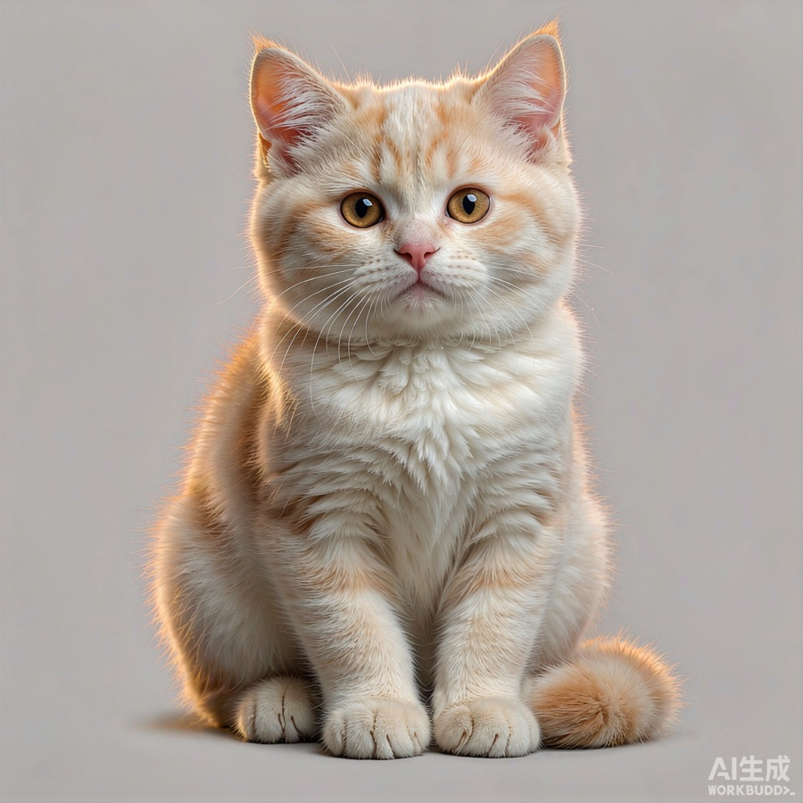
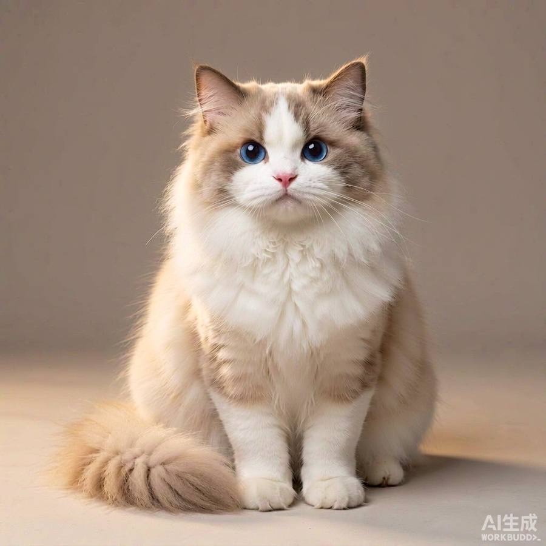
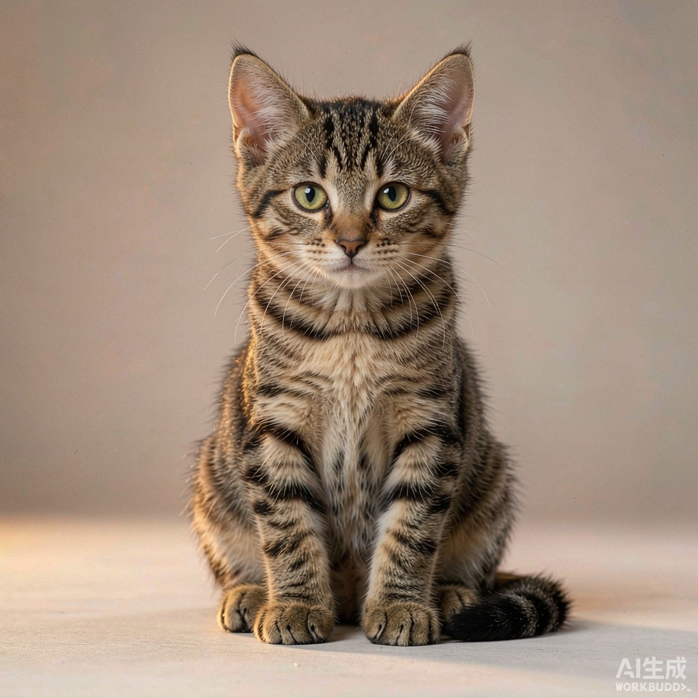
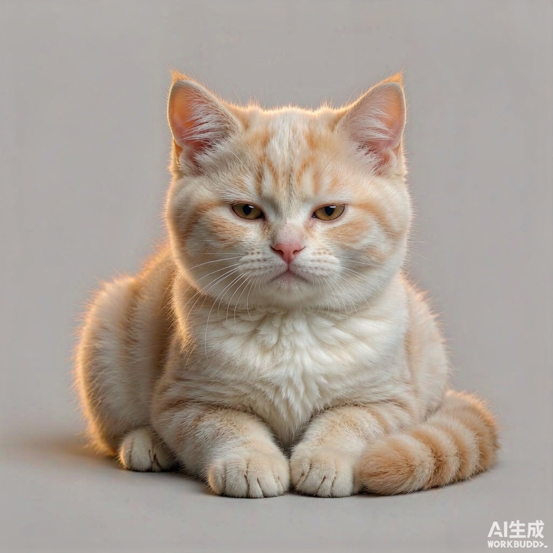
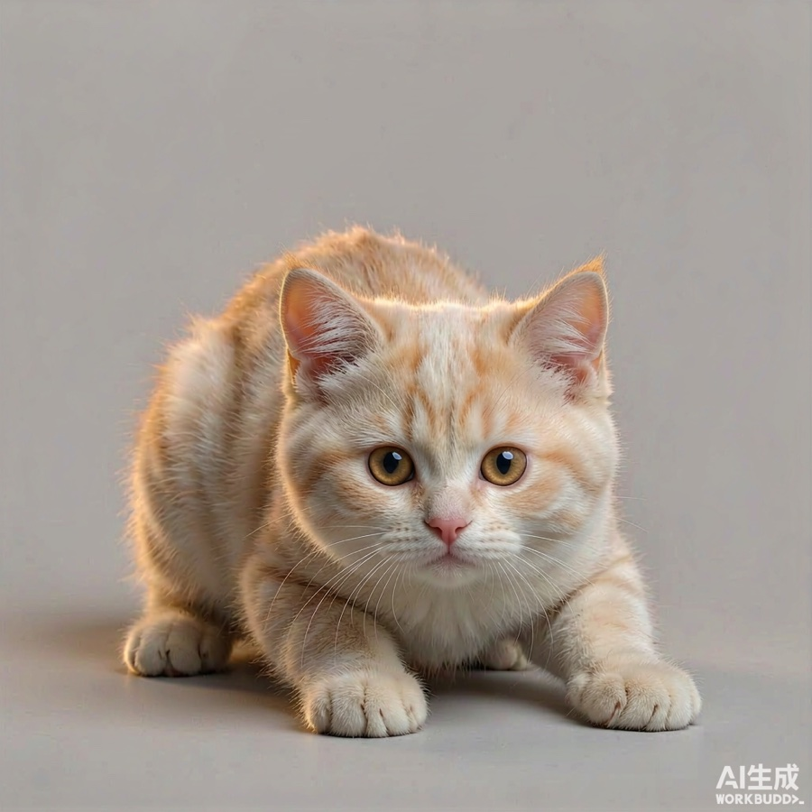

<div align="center">

# 🐱 猫房间 · 三只会呼噜的猫

**一个用 AI 养出来的宠物猫网页应用**——三只性格各异的小猫住在一间屋子里，会饿、会无聊、会讨食、会翻肚皮，还会用 DeepSeek 的大脑跟你聊天。

<br>

[](https://718997675.github.io/cat-pet/)
[](LICENSE)
[](.)
[](https://www.deepseek.com/)

<br>



<sub>这是橘子，一只奶油橘。它还有两个室友，往下看 ↓</sub>

</div>

---

## 这是什么

一个可以**在浏览器里养的猫**。不需要安装、不需要注册、不需要后端——打开网页，三只小猫就坐在那儿等你。

它和你见过的静态壁纸不一样：猫有自己的**情绪和身体状态**，会随时间变化；你不理它，它会饿、会无聊，甚至主动开口讨食。而当你打字或按住麦克风跟它说话时，它会调用 **DeepSeek** 的大脑，用自己的性格回你一句——每只猫的说话风格都不一样。

整个项目就是一个 `index.html`（99.9% 是 HTML/CSS/JS 写的，没有构建工具、没有 npm 依赖），双击就能玩，也能直接丢到任何静态服务器上（现在已经挂在 GitHub Pages 上）。

## 住客名单

三只四个月大的小猫，各有各的脾气：

<table>
<tr>
<td align="center" width="33%">
<br>
<b>橘子</b><br><sub>奶油橘 · 四个月</sub>
</td>
<td align="center" width="33%">
<br>
<b>团子</b><br><sub>双色布偶 · 四个月</sub>
</td>
<td align="center" width="33%">
<br>
<b>阿狸</b><br><sub>中华狸花 · 四个月</sub>
</td>
</tr>
</table>

点顶部的名字就能切换。切猫的瞬间，四项状态会立刻刷新成这只猫自己的数据——它们各过各的，记忆不共享。

## 能玩什么

### 🖱️ 摸它、逗它、喂它

- **抚摸 / 扑击**：猫会换姿势、轻微位移，还有扑击动画（拖动猫台时它会跟着看）。
- **喂食**：点「食盆」按钮给它倒一碗猫粮，饱食度上来了，它会很满足。肚子饿了它会自己弹提示讨食。
- **喵语开关**：每只猫有 6 段**真实猫叫录音**，会根据情绪和你说的话随机喵 1~2 声，不冗长。不喜欢可以一键关掉。

### 📊 四项状态，看得见的情绪

猫的状态不是装饰，是真的在跑的一套小生态：

| 状态 | 含义 | 怎么变 |
|------|------|--------|
| 😊 **心情** | 开心程度 | 互动、玩耍会上升，被冷落会下降 |
| 🍚 **饱食** | 饿不饿 | 随时间下降，喂食回满，饿了会讨食 |
| 🎾 **兴致** | 想不想玩 | 久了不理会无聊，逗它会回升 |
| 💛 **亲近** | 和你多熟 | 长期互动慢慢积累 |

状态会实时显示成四条小进度条，低于阈值会变色告警。猫还会**自主活动**——哪怕你什么都不点，它也会自己在那儿发呆、换姿势、打盹，偶尔弹出一句"它在伸懒腰"之类的生活提示。

### 🧠 DeepSeek AI 大脑（可选）

这是它最特别的地方。点「AI」按钮填入你自己的 DeepSeek API Key，猫就"活"了：

- 你打字或**按住麦克风说话**，它只在你说话时调用一次 `deepseek-flash`，用猫的性格回你；
- 每只猫有**独立的语气人设**——布偶会温柔，狸花会傲娇，回答自带性格；
- **Key 只存在你自己的浏览器里**（localStorage），不上传任何服务器；也支持用一次性链接 `?k=` 注入；
- 没有 Key 也能玩——猫会用内置的离线台词库回应你，**0 成本**。

> 配置支持「DeepSeek 云模型」和「自定义代理」两种模式，填写区有密码遮蔽，绝不会回显。

### 📔 猫咪日志

它会把自己的生活写下来。每次互动、状态明显变化、或者每隔两分钟，都会自动记一笔，存成看得懂的文字：

- **实时状态**：当前这只猫的心情、饱食、兴致、亲近一栏看清；
- **历史记录**：带时间戳的流水，分「你说 / 猫咪回应 / 喂食 / 讨食 / 玩耍 / 抚摸」等标签；
- 可以**手动「记一笔」**、**清空历史**，记录只保留最近 30 天，不会撑爆浏览器。

### 🌙 跨天记忆

关掉网页再打开，猫还记得你。状态、日志、亲近度全部存在浏览器 `localStorage` 里，连"上次是哪天来的"都记着——隔天回来，它会因为跨天而产生状态变化，像真的养了一阵子。

## 五种姿态

每只猫准备了 5 张姿态图，配合待机时的活体视频层，切换时有平滑过渡，不会闪空白/破图：

| 坐着 | 趴着（面包） | 翻肚皮 | 准备扑 | 喵 |
|------|------|------|------|------|
|  |  |  |  |  |

## 本地运行

```bash
# 方式一：直接双击 index.html（推荐，零依赖）
# 方式二：起一个静态服务
python3 -m http.server 8000
# 打开 http://localhost:8000
```

首次加载时猫的素材会逐步就位；如果手机浏览器拦了自动播放，点一下画面就能唤醒。横竖屏都做了适配。

## 技术栈

| | |
|---|---|
| **核心** | 原生 HTML + CSS + JavaScript，单文件 |
| **构建** | 无。零 npm 依赖，`file://` 双击即开 |
| **AI** | DeepSeek `deepseek-flash`（OpenAI 兼容接口，可换自定义代理） |
| **语音** | Web Speech API（语音识别）+ 真实猫叫录音 |
| **存储** | 浏览器 localStorage（状态 / 日志 / AI 配置全在本机） |
| **部署** | GitHub Pages 静态托管 |

## 目录结构

```
cat-pet/
├── index.html          # 应用主体（界面 + 逻辑 + 样式，全在这一个文件里）
├── ai.local.js         # 线上配置占位（Key 不入库，只在访客浏览器里）
├── .nojekyll           # 让 GitHub Pages 正确处理静态资源
└── assets/
    ├── cat-*.jpg       # 橘子：坐 / 趴 / 肚皮 / 扑 / 喵
    ├── rag-*.jpg       # 团子：坐 / 趴 / 肚皮 / 扑 / 喵
    ├── tabby-*.jpg     # 阿狸：坐 / 趴 / 肚皮 / 扑 / 喵
    ├── audio/          # 真实猫叫录音
    └── video/          # 待机活体视频
```

## 关于

一个用 AI 一点点"养"出来的小项目——从三张静态猫图，到会自主活动的生态、会说话的大脑、会写日记的记忆，全部由 AI 辅助开发完成。

如果你也喜欢撸猫、或者想一起做点有意思的 AI 小应用，欢迎来 GitHub 点个 star、开个 issue 聊聊。

MIT License · Made with 🤎 and AI
